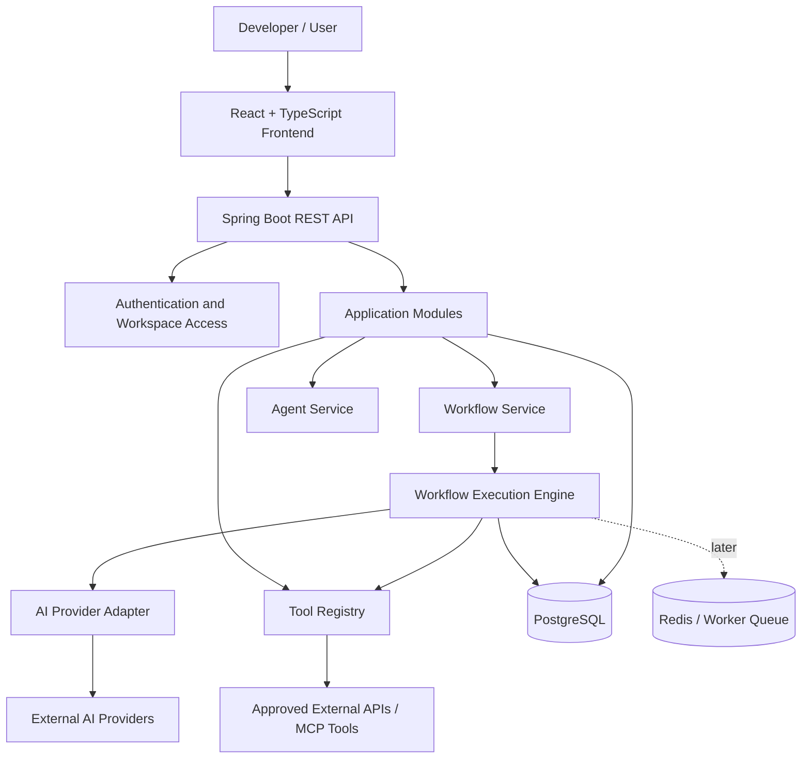

# System Architecture

## 1. Architecture goals

The system should be:
- Modular and straightforward to develop as a student/startup project.
- Reliable for long-running workflow execution.
- Secure across users and workspaces.
- Extensible for multiple AI providers and tools.
- Observable and testable.

**Recommended approach:** Start with a modular monolith. Keep clear module boundaries so individual components can be extracted later if real scale requires it.

## 2. Recommended technology stack

| Layer | Technology | Purpose |
|---|---|---|
| Backend | Java 21 LTS + Spring Boot 3.x | REST API and application services |
| Security | Spring Security | Authentication and authorization |
| Persistence | Spring Data JPA / Hibernate | Relational data access |
| Database | PostgreSQL | Primary persistent storage |
| Migrations | Flyway | Version-controlled schema changes |
| Cache / queue support | Redis | Caching and later background coordination |
| Build | Maven | Java dependency and build management |
| Frontend | React + TypeScript + Vite | Web application |
| Styling | Tailwind CSS | UI styling |
| Workflow canvas | React Flow / XYFlow | Visual workflow editor |
| AI integration | Spring AI or provider adapters | Model access |
| Tool integration | MCP Java SDK where appropriate | Model Context Protocol integrations |
| Testing | JUnit 5, Mockito, Testcontainers | Unit and integration tests |
| Deployment | Docker / Docker Compose | Local and production packaging |
| Observability | Structured logs; later OpenTelemetry and Prometheus | Diagnostics and metrics |

Use a Java/Spring version combination that is supported by the selected dependency versions. Confirm compatibility before upgrading the Java baseline.

## 3. High-level architecture



## 4. Backend module boundaries

Suggested Java package structure:

```text
com.yourproduct
├── common
│   ├── config
│   ├── exception
│   ├── response
│   └── security
├── auth
├── workspace
├── agent
├── provider
├── tool
├── workflow
├── execution
├── approval
├── scheduler
├── usage
└── audit
```

Each module should own its domain logic and expose services or interfaces to other modules. Avoid controllers calling repositories belonging to unrelated modules.

### Module responsibilities

- **auth:** registration, login, tokens, password handling.
- **workspace:** workspace creation, membership, roles, tenant boundaries.
- **agent:** agent configuration, prompt versioning, agent tests.
- **provider:** model-provider configuration and secure credential handling.
- **tool:** tool definitions, permissions, input validation, invocation adapters.
- **workflow:** workflow definitions, nodes, edges, validation, versioning.
- **execution:** orchestration, state transitions, node execution, logs, retries.
- **approval:** pending human decisions and approval history.
- **scheduler:** scheduled workflow triggers (later release).
- **usage:** token counts, execution duration, cost estimates and quotas.
- **audit:** security-sensitive and administrative events.

## 5. Core execution abstractions

Keep the engine independent of specific AI providers and tool implementations.

Illustrative Java contracts:

```java
public interface Agent {
    String getName();
    AgentResult execute(AgentTask task);
}

public interface WorkflowNode {
    NodeResult execute(ExecutionContext context);
}
```

Possible node implementations:
- `AgentNode`
- `ToolNode`
- `OutputNode`
- `ConditionNode` (P1)
- `DelayNode` (P1)
- `ApprovalNode` (P1)

Important design rules:
- Pass an explicit execution context to nodes.
- Keep node inputs and outputs structured and serializable.
- Persist state transitions.
- Set timeouts and resource limits.
- Make retry behavior depend on node type and idempotency.
- Do not let a node bypass workspace authorization.
- When publishing a workflow version, snapshot each referenced agent's non-secret settings into its versioned node configuration. Resolve its provider credential by workspace-scoped ID at run time.
- Resolve every credential reference using both its ID and the execution workspace ID; fail closed if it does not belong to that workspace.

## 6. Frontend structure

Suggested project structure:

```text
frontend/
├── src/
│   ├── app/
│   ├── components/
│   ├── features/
│   │   ├── auth/
│   │   ├── dashboard/
│   │   ├── agents/
│   │   ├── workflows/
│   │   ├── executions/
│   │   ├── integrations/
│   │   └── settings/
│   ├── hooks/
│   ├── lib/
│   ├── services/
│   ├── types/
│   └── styles/
└── package.json
```

Main screens:
1. Dashboard
2. Agents
3. Agent Studio
4. Workflow Studio
5. Execution Center
6. Execution Details
7. Integrations
8. Workspace Settings

The frontend should not contain provider API secrets. It should call the backend using authenticated API requests.

## 7. API design

Use versioned REST endpoints under `/api/v1`.

| Area | Example endpoints |
|---|---|
| Authentication | `POST /auth/register`, `POST /auth/login` |
| Workspaces | `GET /workspaces`, `POST /workspaces` |
| Agents | `GET /workspaces/{workspaceId}/agents`, `POST /workspaces/{workspaceId}/agents` |
| Workflows | `GET /workspaces/{workspaceId}/workflows`, `POST /workspaces/{workspaceId}/workflows` |
| Execution | `POST /workflows/{workflowId}/executions` |
| Execution details | `GET /executions/{executionId}` |
| Logs | `GET /executions/{executionId}/logs` |
| Cancellation | `POST /executions/{executionId}/cancel` |
| Approval | `POST /approvals/{approvalId}/decision` |

Use DTOs at the API boundary. Do not expose JPA entities directly.

## 8. Workflow execution design

A workflow definition consists of:
- Nodes with unique IDs and typed configuration.
- Directed edges describing execution order.
- Input and output mappings.
- A workflow version.

Execution flow:
1. Authenticate the request.
2. Verify workspace access.
3. Load and validate a specific immutable workflow version.
4. In one database transaction, create a `PENDING` execution row, which is also the durable queue item. Hash the canonical workflow ID, version ID, and normalized input. For a repeated request idempotency key, return the prior execution only when the request hash matches; otherwise return a conflict.
5. Resolve the starting node.
6. Execute eligible nodes.
7. Persist node inputs, outputs, status and logs.
8. Follow outgoing edges according to node results.
9. Pause for approval when required (post-MVP).
10. Mark the execution completed, failed or cancelled.

Each execution refers to an immutable workflow version. Published versions are append-only; edits create a new version. The version includes snapshots of non-secret agent settings, so editing a reusable agent does not silently change an existing version. Credentials remain references to workspace-owned secrets and may be rotated independently.

## 9. Real-time updates

MVP option:
- Start with polling execution status and logs.

Later options:
- Server-Sent Events (SSE) for one-way execution updates.
- WebSockets if interactive bidirectional communication is needed.

Do not add real-time infrastructure before the basic execution lifecycle works.

## 10. Background execution

For the MVP, use PostgreSQL as the durable work queue: workers claim pending execution rows with a short transaction using `FOR UPDATE SKIP LOCKED`, then save the lease owner and expiry before doing work. A worker periodically records a heartbeat. A reaper returns expired claims to the queue unless an in-flight non-idempotent tool call has an unknown outcome; then it marks that node `OUTCOME_UNKNOWN` and the execution `FAILED` for operator resolution. This keeps pending work from being lost with an in-memory executor.

Later:
- Use Redis-backed queueing or a durable job system.
- Separate API request handling from workflow workers.
- Apply per-workspace concurrency limits.

Redis alone should not be treated as the source of truth for workflow history; PostgreSQL remains authoritative.

Execution is at-least-once: a worker can lose its lease after an external tool has acted but before the result is saved. Give each logical node action a stable invocation key across retries and pass it to tools that support idempotency. If a non-idempotent call has an unknown outcome, do not replay it automatically; surface the uncertainty for an operator to resolve.

Cancellation is cooperative. Persist a cancellation request, check it before starting each node and after the current node returns, then mark the execution cancelled at that boundary. Do not report an in-flight external action as undone; a cancellation request cannot reverse a side effect that already occurred.

## 11. Security architecture

- Enforce workspace-level authorization in backend services.
- Encrypt API credentials using a managed key or a well-designed application encryption scheme.
- Keep encryption keys outside the database and source repository.
- Redact secrets from logs and error messages.
- Validate tool schemas and run network-capable tools through a worker with outbound access denied by default. Allow only explicitly approved destinations; reject loopback, private, link-local, multicast and cloud metadata addresses; pin a vetted DNS result for the connection; and revalidate every redirect target.
- Do not expose cloud instance credentials or unrestricted internal network access to tool workers.
- Apply rate limits and quotas.
- Treat model output and tool output as untrusted input.
- Limit MVP tools to read-only or low-risk actions. Require an approval node before enabling sensitive actions in the P1 release.
- Never execute arbitrary user-supplied Java code inside the backend JVM.

## 12. Testing strategy

- Unit tests for domain rules and state transitions.
- Service tests for authorization and workflow validation.
- Integration tests using Testcontainers for PostgreSQL.
- API tests for authentication and tenant isolation.
- Execution-engine tests for success, failure, cancellation, retries and approvals.
- Frontend tests for critical workflow-builder interactions.
- End-to-end tests for create-agent → build-workflow → execute → inspect.

## 13. Deployment topology

Initial deployment:
- React frontend.
- Spring Boot application.
- PostgreSQL database.
- Optional Redis service.
- Reverse proxy / managed ingress.
- Secret manager or protected environment configuration.

Use Docker Compose for local development. Add production orchestration only when deployment needs justify it.
