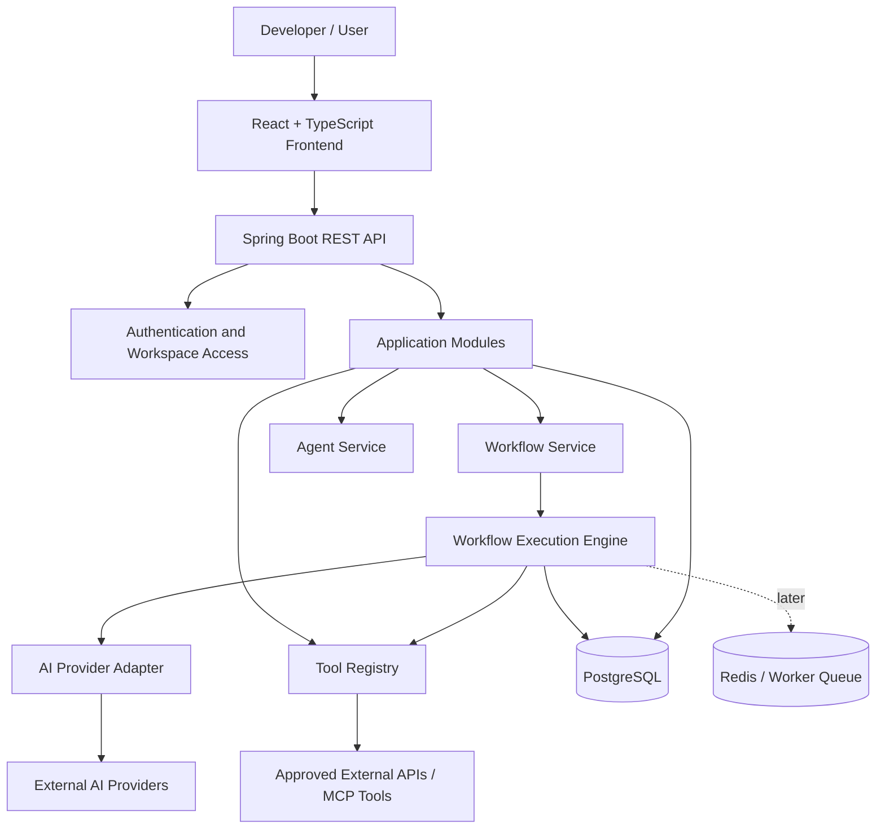

# System Architecture

## 1. Architecture goals

The system should be:
- Modular and straightforward to develop as a student/startup project.
- Reliable for long-running workflow execution.
- Secure across users and workspaces.
- Extensible for multiple AI providers and tools.
- Observable and testable.

**Recommended approach:** Start with a modular monolith. Keep clear module boundaries so individual components can be extracted later if real scale requires it.

## 2. Recommended technology stack

| Layer | Technology | Purpose |
|---|---|---|
| Backend | Java 21 LTS + Spring Boot 3.x | REST API and application services |
| Security | Spring Security | Authentication and authorization |
| Persistence | Spring Data JPA / Hibernate | Relational data access |
| Database | PostgreSQL 16 | Primary persistent storage; native Windows service for local development, `postgres:16` container in CI and production |
| Migrations | Flyway | Version-controlled schema changes |
| Cache / queue support | Redis | Caching and later background coordination |
| Build | Maven | Java dependency and build management |
| Frontend | React + TypeScript + Vite | Web application |
| Styling | Tailwind CSS | UI styling |
| Workflow canvas | React Flow / XYFlow | Visual workflow editor |
| AI integration | Spring AI or provider adapters | Model access |
| Tool integration | MCP Java SDK where appropriate | Model Context Protocol integrations |
| Testing | JUnit 5, Mockito, Testcontainers | Unit and integration tests |
| Deployment | Docker / Docker Compose | CI and production packaging; local development runs PostgreSQL natively |
| Observability | Structured logs; later OpenTelemetry and Prometheus | Diagnostics and metrics |

Use a Java/Spring version combination that is supported by the selected dependency versions. Confirm compatibility before upgrading the Java baseline.

## 3. High-level architecture



## 4. Backend module boundaries

Suggested Java package structure:

```text
com.yourproduct
├── common
│   ├── config
│   ├── exception
│   ├── response
│   └── security
├── auth
├── workspace
├── agent
├── provider
├── tool
├── workflow
├── execution
├── approval
├── scheduler
├── usage
└── audit
```

Each module should own its domain logic and expose services or interfaces to other modules. Avoid controllers calling repositories belonging to unrelated modules.

### Module responsibilities

- **auth:** registration, login, tokens, password handling.
- **workspace:** workspace creation, membership, roles, tenant boundaries.
- **agent:** agent configuration, prompt versioning, agent tests.
- **provider:** model-provider configuration and secure credential handling.
- **tool:** tool definitions, permissions, input validation, invocation adapters.
- **workflow:** workflow definitions, nodes, edges, validation, versioning.
- **execution:** orchestration, state transitions, node execution, logs, retries.
- **approval:** pending human decisions and approval history.
- **scheduler:** scheduled workflow triggers (later release).
- **usage:** token counts, execution duration, cost estimates and quotas.
- **audit:** security-sensitive and administrative events.

## 5. Core execution abstractions

Keep the engine independent of specific AI providers and tool implementations.

Illustrative Java contracts:

```java
public interface Agent {
    String getName();
    AgentResult execute(AgentTask task);
}

public interface WorkflowNode {
    NodeResult execute(ExecutionContext context);
}
```

Possible node implementations:
- `AgentNode`
- `ToolNode`
- `OutputNode`
- `ConditionNode` (P1)
- `DelayNode` (P1)
- `ApprovalNode` (P1)

Important design rules:
- Pass an explicit execution context to nodes.
- Keep node inputs and outputs structured and serializable.
- Persist state transitions.
- Set timeouts and resource limits.
- Make retry behavior depend on node type and idempotency.
- Do not let a node bypass workspace authorization.
- When publishing a workflow version, snapshot each referenced agent's non-secret settings into its versioned node configuration. Resolve its provider credential by workspace-scoped ID at run time.
- Resolve every credential reference using both its ID and the execution workspace ID; fail closed if it does not belong to that workspace.

## 6. Frontend structure

Suggested project structure:

```text
frontend/
├── src/
│   ├── app/
│   ├── components/
│   ├── features/
│   │   ├── auth/
│   │   ├── dashboard/
│   │   ├── agents/
│   │   ├── workflows/
│   │   ├── executions/
│   │   ├── integrations/
│   │   └── settings/
│   ├── hooks/
│   ├── lib/
│   ├── services/
│   ├── types/
│   └── styles/
└── package.json
```

Main screens:
1. Dashboard
2. Agents
3. Agent Studio
4. Workflow Studio
5. Execution Center
6. Execution Details
7. Integrations
8. Workspace Settings

The frontend should not contain provider API secrets. It should call the backend using authenticated API requests.

## 7. API design

Use versioned REST endpoints under `/api/v1`.

| Area | Example endpoints |
|---|---|
| Authentication | `POST /auth/register`, `POST /auth/login`, `POST /auth/logout`, `GET /auth/me`, `GET /auth/csrf` |
| Workspaces | `GET /workspaces`, `POST /workspaces`, `GET /workspaces/{workspaceId}`, `GET/POST /workspaces/{workspaceId}/members`, `DELETE /workspaces/{workspaceId}/members/{userId}` |
| Providers | `GET/POST /workspaces/{workspaceId}/providers`, `DELETE /workspaces/{workspaceId}/providers/{credentialId}` |
| Agents | `GET/POST /workspaces/{workspaceId}/agents`, `GET/PATCH/DELETE /workspaces/{workspaceId}/agents/{agentId}`, `POST /workspaces/{workspaceId}/agents/{agentId}/test` |
| Workflows | `GET/POST /workspaces/{workspaceId}/workflows`, `GET/PATCH/DELETE /workspaces/{workspaceId}/workflows/{workflowId}` |
| Workflow versions | `GET/POST /workspaces/{workspaceId}/workflows/{workflowId}/versions`, `GET /workspaces/{workspaceId}/workflows/{workflowId}/versions/{versionNumber}` |
| Execution | `POST /workspaces/{workspaceId}/workflows/{workflowId}/executions`, `GET /workspaces/{workspaceId}/executions` |
| Execution details | `GET /workspaces/{workspaceId}/executions/{executionId}` |
| Logs | `GET /workspaces/{workspaceId}/executions/{executionId}/logs` |
| Cancellation | `POST /workspaces/{workspaceId}/executions/{executionId}/cancel` |
| Approval | `POST /approvals/{approvalId}/decision` |

Use DTOs at the API boundary. Do not expose JPA entities directly.

### Authentication transport (M4)

- Authentication uses a server-side session identified by an HTTP-only
  `MELD_SESSION` cookie (`SameSite=Lax`; `Secure` outside local development).
  Login is handled in `AuthController` so requests and responses are JSON; the
  session id is rotated on login to prevent session fixation.
- CSRF protection stays enabled for every state-changing request. Browser
  clients call `GET /auth/csrf`, then echo the readable `XSRF-TOKEN` cookie in
  the `X-XSRF-TOKEN` header (cookie double-submit).
- Unauthenticated requests to protected endpoints return `401`; insufficient
  role returns `403`. A workspace the caller does not belong to is reported as
  `404`, so membership cannot be probed.
- Global authority is `ROLE_USER` only. Workspace roles (`OWNER`, `MEMBER`) are
  per-workspace and enforced by `WorkspaceAccessService` on every
  workspace-scoped operation; they are not stored in the session.

### Provider calls (M5)

- Provider base URLs are server configuration (`meld.providers.base-urls.*`),
  never request input, so a workspace cannot point the backend at an internal
  host. `OPENROUTER_BASE_URL` and the other overrides exist for gateways and
  local stubs.
- The OpenAI-compatible chat-completions adapter serves OpenRouter first and
  also covers OpenAI, Groq and Ollama endpoints. Secrets are decrypted only for
  the duration of a call.
- Default transport limits are 10 s connect and 60 s read (`PROVIDER_CONNECT_TIMEOUT`,
  `PROVIDER_READ_TIMEOUT`).
- Upstream failures map to stable codes: `PROVIDER_AUTH_FAILED`,
  `PROVIDER_RATE_LIMITED`, `PROVIDER_ERROR`, `PROVIDER_TIMEOUT`,
  `PROVIDER_BAD_RESPONSE`. The upstream body and the API key are never relayed
  or logged.
- Any workspace member can build and test agents. Provider credentials are
  `OWNER`-managed, and a credential from another workspace is rejected.

### Workflow versions and execution (M6)

- A workflow is metadata only. All definition state lives in an immutable
  version: `POST /workspaces/{workspaceId}/workflows/{workflowId}/versions`
  creates the next version together with its nodes and edges in one request.
- Node types are `agent`, `tool` and `output`. The MVP engine is sequential, so
  a version must be one unbranched chain: unique node keys, exactly one start
  node, at most one outgoing edge per node, every node reachable, and no cycles.
  Violations return `400` with code `WORKFLOW_INVALID`.
- `publish: true` sets `published_at` and marks the workflow `PUBLISHED`.
  Executions require a published version: without `versionId` the latest
  published version is used, and an unpublished version returns `409`
  `WORKFLOW_NOT_PUBLISHED`.
- At version creation an agent node copies non-secret settings (name, model,
  system prompt, temperature, max output tokens) into its configuration and
  keeps only the workspace-scoped `providerCredentialId`. Editing the reusable
  agent afterwards does not change the version; saving the workflow again
  creates version `n + 1`.
- Workflow lists are workspace-scoped. A workflow, version or execution in
  another workspace is reported as `404`, and the database composite foreign
  keys reject cross-workspace links even if an application check is bypassed.
- Deleting a workflow that already has executions returns `409`
  `WORKFLOW_IN_USE`; history keeps an immutable reference to the version it ran.
- Starting an execution returns `201` with a `PENDING` summary. An idempotent
  replay with the same key, version and canonical input returns `200` with the
  original execution; reusing the key for different content returns `409`
  `IDEMPOTENCY_CONFLICT`.
- Execution history and logs use a stable page envelope:
  `{items, page, size, totalElements, totalPages}`.
- Cancelling a `PENDING` execution marks it `CANCELLED` immediately. A `RUNNING`
  execution records `cancelRequestedAt` and stops at the next node boundary.
  Finished executions return `409` `EXECUTION_NOT_CANCELLABLE`.

## 8. Workflow execution design

A workflow definition consists of:
- Nodes with unique IDs and typed configuration.
- Directed edges describing execution order.
- Input and output mappings.
- A workflow version.

Execution flow (M6 implementation):
1. Authenticate the request and verify workspace membership.
2. Load the requested published version, or the latest published version.
3. In one database transaction, create a `PENDING` execution row, which is also the durable queue item. Hash the canonical workflow ID, version ID, and normalized input. For a repeated request idempotency key, return the prior execution only when the request hash matches; otherwise return a conflict.
4. A worker claims the row with `FOR UPDATE SKIP LOCKED`, records its lease and heartbeat, and runs the chain in order.
5. Each node reads a rendered input (`workflowInput`, `previous`, and named node outputs) and writes an `input JSONB`, `output JSONB`, status and timestamps to its own `node_executions` row.
6. Agent nodes call the provider through the snapshot; tool nodes run the read-only tool runtime; output nodes render a JSON template.
7. Every node start, completion and failure is appended to `execution_logs`. Provider usage is written to `usage_records`.
8. The execution is marked `COMPLETED`, `FAILED` or `CANCELLED`, and the lease is released.

Each execution refers to an immutable workflow version. Published versions are append-only; edits create a new version. The version includes snapshots of non-secret agent settings, so editing a reusable agent does not silently change an existing version. Credentials remain references to workspace-owned secrets and may be rotated independently. Tool output and model output are data, never instructions.

## 9. Real-time updates

MVP option:
- Start with polling execution status and logs.

Later options:
- Server-Sent Events (SSE) for one-way execution updates.
- WebSockets if interactive bidirectional communication is needed.

Do not add real-time infrastructure before the basic execution lifecycle works.

## 10. Background execution

For the MVP, use PostgreSQL as the durable work queue: workers claim pending execution rows with a short transaction using `FOR UPDATE SKIP LOCKED`, then save the lease owner and expiry before doing work. A worker periodically records a heartbeat. A reaper returns expired claims to the queue unless an in-flight non-idempotent tool call has an unknown outcome; then it marks that node `OUTCOME_UNKNOWN` and the execution `FAILED` for operator resolution. This keeps pending work from being lost with an in-memory executor.

Implementation notes (M6):

- `ExecutionWorker` runs on a scheduled poll (`meld.execution.poll-interval-ms`,
  default 500 ms) and claims at most `max-per-poll` rows per pass.
- A separate heartbeat pass extends only leases this worker still owns, so a long
  provider call does not look abandoned. A bulk update is used so a heartbeat
  cannot overwrite a status change committed after it read the row.
- The lease defaults to 2 minutes (`MELD_EXECUTION_LEASE_DURATION`) and exceeds
  the 60 s provider read timeout.
- Recovery ignores leases owned by the live worker and locks each expired row
  while it recovers it, so two instances cannot both act on the same abandoned
  execution. An expired lease with no
  `RUNNING` node returns to `PENDING`; completed nodes are not repeated because
  the worker resumes from their saved outputs. An expired lease with a `RUNNING`
  node sets that node to `OUTCOME_UNKNOWN`, sets the execution to `FAILED` with
  code `OUTCOME_UNKNOWN`, and never replays it automatically.
- Node attempt numbers increase per node key, so a future retry can add a new
  attempt without violating `(execution_id, node_key, attempt_number)`.
- Run-time failures persist a stable code (`PROVIDER_TIMEOUT`,
  `PROVIDER_AUTH_FAILED`, `TOOL_EGRESS_BLOCKED`, ...) and a safe message. Raw
  exception text is never stored.
- Tests set `meld.execution.worker-enabled: false` and drive
  `ExecutionWorker.claimAndRunOne()` directly; production enables the scheduler.
- The MVP has no retryable side-effecting tools, so a stable invocation key is
  not yet persisted. It becomes part of the retry contract when retries and
  write-capable tools ship (M8/P1).

Later:
- Use Redis-backed queueing or a durable job system.
- Separate API request handling from workflow workers.
- Apply per-workspace concurrency limits.

Redis alone should not be treated as the source of truth for workflow history; PostgreSQL remains authoritative.

Execution is at-least-once: a worker can lose its lease after an external tool has acted but before the result is saved. Give each logical node action a stable invocation key across retries and pass it to tools that support idempotency. If a non-idempotent call has an unknown outcome, do not replay it automatically; surface the uncertainty for an operator to resolve.

Cancellation is cooperative. Persist a cancellation request, check it before starting each node and after the current node returns, then mark the execution cancelled at that boundary. Do not report an in-flight external action as undone; a cancellation request cannot reverse a side effect that already occurred.

## 11. Security architecture

- Enforce workspace-level authorization in backend services.
- Encrypt API credentials using a managed key or a well-designed application encryption scheme.
- Load the credential-encryption key from the environment; refuse to start when it is missing or is not a 32-byte AES key.
- Keep encryption keys outside the database and source repository.
- Redact secrets from logs and error messages.
- Validate tool schemas and run network-capable tools through a worker with outbound access denied by default. Allow only explicitly approved destinations; reject loopback, private, link-local, multicast and cloud metadata addresses; pin a vetted DNS result for the connection; and revalidate every redirect target.
- M6 tool runtime details: `http_get` is HTTPS-only unless a deployment sets
  `meld.tools.allow-insecure-http`; literal addresses and metadata hostnames are
  rejected when the version is saved; at run time the guard resolves one
  approved address and the client connects to exactly that address, so DNS
  cannot change between validation and connect. Redirects are resolved and
  revalidated hop by hop (default limit 3) on a client with no proxy and no
  connection reuse. Responses are capped (`meld.tools.max-response-bytes`,
  default 1 MiB). `json_transform` runs locally and cannot execute user code.
- Do not expose cloud instance credentials or unrestricted internal network access to tool workers.
- Apply rate limits and quotas.
- Treat model output and tool output as untrusted input.
- Limit MVP tools to read-only or low-risk actions. Require an approval node before enabling sensitive actions in the P1 release.
- Never execute arbitrary user-supplied Java code inside the backend JVM.

## 12. Testing strategy

- Unit tests for domain rules and state transitions.
- Service tests for authorization and workflow validation.
- Integration tests against a real PostgreSQL 16 instance: a dedicated database on the native local service (`meld_test`), Testcontainers where Docker is available, and a `postgres:16` service container in CI.
- API tests for authentication and tenant isolation.
- Execution-engine tests for success, failure, cancellation, retries and approvals.
- Frontend tests for critical workflow-builder interactions.
- End-to-end tests for create-agent → build-workflow → execute → inspect.

## 13. Deployment topology

Initial deployment:
- React frontend.
- Spring Boot application.
- PostgreSQL database.
- Optional Redis service.
- Reverse proxy / managed ingress.
- Secret manager or protected environment configuration.

Add production orchestration only when deployment needs justify it.

### Local development environment (decided)

Local development on Windows uses a **native PostgreSQL 16 service**, not a container:

| Item | Value |
|---|---|
| Version | PostgreSQL 16 (EDB Windows installer, runs as service `postgresql-x64-16`) |
| Host / port | `localhost:5432` |
| Application role | `meld` — `LOGIN`, no `SUPERUSER`, no `CREATEDB`, no `CREATEROLE` |
| Dev database | `meld` (owner `meld`) |
| Test database | `meld_test` (owner `meld`) |
| Auth method | `scram-sha-256` for `local`, `127.0.0.1/32` and `::1/128` |

Reasoning: the target machine has limited RAM and no WSL2, so Docker Desktop would cost far more than it returns for a single-database project. Docker is not required by any part of the design — the database is the only always-on dependency in the MVP, and Redis is explicitly deferred.

Consequences:

- Integration tests run against `meld_test` with Flyway cleaning the schema between runs. The test datasource is hard-wired to `meld_test` so a misconfigured run cannot touch `meld`. If test isolation later becomes a problem, switch to `io.zonky.test:embedded-postgres`, which runs real PostgreSQL binaries without Docker.
- CI and production still use a `postgres:16` container, so the deployment topology above is unchanged.
- Whenever `infrastructure/docker-compose.yml` is written, it must pin `postgres:16` on port 5432 with the same database and role names, so local and containerised environments are interchangeable.
- Connection settings come from environment variables (`.env`, never committed); `.env.example` carries placeholders only.
