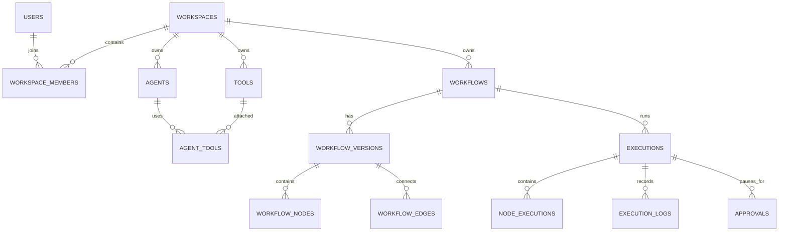

# Database Design

## 1. Database choice

Use PostgreSQL as the primary database.

Reasons:
- Strong relational constraints.
- Transactions for workflow and execution state.
- JSONB support for flexible node configuration and structured outputs.
- Mature indexing, backup, and migration tooling.

Use Flyway for schema migrations. Treat this document as the logical starting design; implement and evolve the physical schema through reviewed migrations.

Local development targets a native **PostgreSQL 16** service on `localhost:5432` with the application role `meld` and two databases, `meld` (development) and `meld_test` (integration tests). CI and production use a `postgres:16` container with the same names. See `ARCHITECTURE.md` §13 for the decision and its consequences. Use the `psql`, `pg_dump` and `pg_restore` binaries from the PostgreSQL 16 installation for inspection and backup testing.

## 2. Design principles

1. Every tenant-owned record must be associated with a workspace, directly or through a parent.
2. Every request must verify the current user's access to the relevant workspace.
3. Use UUID primary keys.
4. Store timestamps in UTC using `TIMESTAMPTZ`.
5. Store flexible node configuration in JSONB, but keep important relationships relational.
6. Never store plaintext provider API keys.
7. Preserve execution history and the workflow version used by each execution.
8. Add indexes based on actual query patterns.

## 3. Core entities

| Entity | Purpose |
|---|---|
| users | User accounts |
| workspaces | Tenant/workspace boundary |
| workspace_members | User membership and role |
| provider_credentials | Encrypted model-provider credentials |
| agents | Reusable agent configurations |
| tools | Approved tool definitions |
| agent_tools | Many-to-many agent/tool association |
| workflows | Workflow metadata |
| workflow_versions | Immutable workflow versions |
| workflow_nodes | Nodes belonging to a workflow version |
| workflow_edges | Directed connections between nodes |
| executions | Workflow execution records |
| node_executions | Per-node execution state and result |
| execution_logs | Structured execution events |
| approvals | Human approval requests and decisions (P1) |
| usage_records | Token, duration and cost usage |
| audit_logs | Security-sensitive activity history |

## 4. Relationships



## 5. Suggested table definitions

The following SQL is illustrative. Convert it into ordered Flyway migrations and refine constraints as the implementation develops.

`workflow_nodes` and `workflow_edges` are the canonical definition for a workflow version. API DTOs can assemble these rows for the editor and runner; do not keep a second full definition copy. Publishing creates a new version. A published version and its nodes and edges are immutable; edits create another version. Agent nodes store a snapshot of the non-secret agent settings they use (provider, model, prompt, and configuration) in their versioned node configuration. Keep only the provider credential ID as a live, workspace-scoped reference so credentials can be rotated without changing historical prompts or models.

### users

Emails are stored normalized (trimmed, lowercased) by the application, and a
functional unique index on `lower(email)` enforces that rule at the database
level so a writer that bypasses the service layer cannot create a case-variant
duplicate account.

```sql
CREATE TABLE users (
    id UUID PRIMARY KEY,
    email VARCHAR(320) NOT NULL UNIQUE,
    password_hash TEXT NOT NULL,
    display_name VARCHAR(120),
    status VARCHAR(30) NOT NULL DEFAULT 'ACTIVE',
    created_at TIMESTAMPTZ NOT NULL DEFAULT NOW(),
    updated_at TIMESTAMPTZ NOT NULL DEFAULT NOW()
);
```

### workspaces and memberships

```sql
CREATE TABLE workspaces (
    id UUID PRIMARY KEY,
    name VARCHAR(120) NOT NULL,
    slug VARCHAR(80) NOT NULL UNIQUE,
    created_by UUID NOT NULL REFERENCES users(id),
    created_at TIMESTAMPTZ NOT NULL DEFAULT NOW(),
    updated_at TIMESTAMPTZ NOT NULL DEFAULT NOW()
);

CREATE TABLE workspace_members (
    workspace_id UUID NOT NULL REFERENCES workspaces(id),
    user_id UUID NOT NULL REFERENCES users(id),
    -- Role vocabulary (M4): OWNER, MEMBER. Stored as text so roles can be
    -- added without a migration; authorization compares parsed enum rank.
    role VARCHAR(30) NOT NULL,
    joined_at TIMESTAMPTZ NOT NULL DEFAULT NOW(),
    PRIMARY KEY (workspace_id, user_id)
);
```

### provider_credentials

```sql
CREATE TABLE provider_credentials (
    id UUID PRIMARY KEY,
    workspace_id UUID NOT NULL REFERENCES workspaces(id),
    provider VARCHAR(60) NOT NULL,
    display_name VARCHAR(120) NOT NULL,
    encrypted_secret BYTEA NOT NULL,
    key_version VARCHAR(40) NOT NULL,
    created_by UUID REFERENCES users(id),
    created_at TIMESTAMPTZ NOT NULL DEFAULT NOW(),
    UNIQUE (workspace_id, id)
);
```

Never put decrypted credentials in API responses or ordinary logs. Keep encryption keys outside PostgreSQL and the repository.

### agents

```sql
CREATE TABLE agents (
    id UUID PRIMARY KEY,
    workspace_id UUID NOT NULL REFERENCES workspaces(id),
    provider_credential_id UUID,
    name VARCHAR(120) NOT NULL,
    description TEXT,
    model VARCHAR(120) NOT NULL,
    system_prompt TEXT NOT NULL,
    configuration JSONB NOT NULL DEFAULT '{}'::jsonb,
    created_by UUID REFERENCES users(id),
    created_at TIMESTAMPTZ NOT NULL DEFAULT NOW(),
    updated_at TIMESTAMPTZ NOT NULL DEFAULT NOW(),
    UNIQUE (workspace_id, name),
    UNIQUE (workspace_id, id),
    FOREIGN KEY (workspace_id, provider_credential_id)
        REFERENCES provider_credentials(workspace_id, id)
);
```

### tools and agent_tools

```sql
CREATE TABLE tools (
    id UUID PRIMARY KEY,
    workspace_id UUID NOT NULL REFERENCES workspaces(id),
    name VARCHAR(120) NOT NULL,
    description TEXT,
    tool_type VARCHAR(40) NOT NULL,
    input_schema JSONB NOT NULL DEFAULT '{}'::jsonb,
    configuration JSONB NOT NULL DEFAULT '{}'::jsonb,
    enabled BOOLEAN NOT NULL DEFAULT TRUE,
    created_at TIMESTAMPTZ NOT NULL DEFAULT NOW(),
    UNIQUE (workspace_id, name),
    UNIQUE (workspace_id, id)
);

CREATE TABLE agent_tools (
    workspace_id UUID NOT NULL REFERENCES workspaces(id),
    agent_id UUID NOT NULL,
    tool_id UUID NOT NULL,
    created_at TIMESTAMPTZ NOT NULL DEFAULT NOW(),
    PRIMARY KEY (agent_id, tool_id),
    FOREIGN KEY (workspace_id, agent_id)
        REFERENCES agents(workspace_id, id) ON DELETE CASCADE,
    FOREIGN KEY (workspace_id, tool_id)
        REFERENCES tools(workspace_id, id) ON DELETE CASCADE
);
```

### workflows and workflow_versions

```sql
CREATE TABLE workflows (
    id UUID PRIMARY KEY,
    workspace_id UUID NOT NULL REFERENCES workspaces(id),
    name VARCHAR(160) NOT NULL,
    description TEXT,
    status VARCHAR(30) NOT NULL DEFAULT 'DRAFT',
    created_by UUID REFERENCES users(id),
    created_at TIMESTAMPTZ NOT NULL DEFAULT NOW(),
    updated_at TIMESTAMPTZ NOT NULL DEFAULT NOW(),
    UNIQUE (workspace_id, id)
);

CREATE TABLE workflow_versions (
    id UUID PRIMARY KEY,
    workflow_id UUID NOT NULL REFERENCES workflows(id) ON DELETE CASCADE,
    version_number INTEGER NOT NULL,
    published_at TIMESTAMPTZ,
    created_at TIMESTAMPTZ NOT NULL DEFAULT NOW(),
    UNIQUE (workflow_id, version_number),
    UNIQUE (workflow_id, id)
);
```

### workflow_nodes and workflow_edges

```sql
CREATE TABLE workflow_nodes (
    id UUID PRIMARY KEY,
    workflow_version_id UUID NOT NULL REFERENCES workflow_versions(id) ON DELETE CASCADE,
    node_key VARCHAR(120) NOT NULL,
    node_type VARCHAR(40) NOT NULL,
    label VARCHAR(160),
    position_x DOUBLE PRECISION NOT NULL DEFAULT 0,
    position_y DOUBLE PRECISION NOT NULL DEFAULT 0,
    configuration JSONB NOT NULL DEFAULT '{}'::jsonb,
    UNIQUE (workflow_version_id, node_key)
);

CREATE TABLE workflow_edges (
    id UUID PRIMARY KEY,
    workflow_version_id UUID NOT NULL REFERENCES workflow_versions(id) ON DELETE CASCADE,
    source_node_key VARCHAR(120) NOT NULL,
    target_node_key VARCHAR(120) NOT NULL,
    condition JSONB,
    created_at TIMESTAMPTZ NOT NULL DEFAULT NOW(),
    FOREIGN KEY (workflow_version_id, source_node_key)
        REFERENCES workflow_nodes(workflow_version_id, node_key) ON DELETE CASCADE,
    FOREIGN KEY (workflow_version_id, target_node_key)
        REFERENCES workflow_nodes(workflow_version_id, node_key) ON DELETE CASCADE
);
```

Reject updates and deletes to published versions and their node and edge rows. Enforce this in the write service and in database triggers if other database writers are allowed. Create a new version for every published change.

### executions and node_executions

```sql
CREATE TABLE executions (
    id UUID PRIMARY KEY,
    workflow_id UUID NOT NULL,
    workflow_version_id UUID NOT NULL,
    workspace_id UUID NOT NULL,
    status VARCHAR(40) NOT NULL,
    input JSONB NOT NULL DEFAULT '{}'::jsonb,
    output JSONB,
    idempotency_key VARCHAR(160),
    request_hash VARCHAR(64),
    lease_owner VARCHAR(160),
    heartbeat_at TIMESTAMPTZ,
    lease_expires_at TIMESTAMPTZ,
    cancel_requested_at TIMESTAMPTZ,
    started_at TIMESTAMPTZ,
    completed_at TIMESTAMPTZ,
    error_code VARCHAR(100),
    error_message TEXT,
    created_by UUID REFERENCES users(id),
    created_at TIMESTAMPTZ NOT NULL DEFAULT NOW(),
    FOREIGN KEY (workspace_id, workflow_id)
        REFERENCES workflows(workspace_id, id),
    FOREIGN KEY (workflow_id, workflow_version_id)
        REFERENCES workflow_versions(workflow_id, id),
    CHECK ((idempotency_key IS NULL) = (request_hash IS NULL)),
    UNIQUE (workspace_id, id)
);

CREATE UNIQUE INDEX uq_execution_idempotency
    ON executions(workspace_id, idempotency_key)
    WHERE idempotency_key IS NOT NULL;

CREATE INDEX idx_executions_workspace_created
    ON executions(workspace_id, created_at DESC);

CREATE INDEX idx_executions_claimable
    ON executions(status, lease_expires_at);

CREATE TABLE node_executions (
    id UUID PRIMARY KEY,
    execution_id UUID NOT NULL REFERENCES executions(id) ON DELETE CASCADE,
    node_key VARCHAR(120) NOT NULL,
    status VARCHAR(40) NOT NULL,
    attempt_number INTEGER NOT NULL DEFAULT 1,
    input JSONB,
    output JSONB,
    error_code VARCHAR(100),
    error_message TEXT,
    started_at TIMESTAMPTZ,
    completed_at TIMESTAMPTZ,
    UNIQUE (execution_id, node_key, attempt_number),
    UNIQUE (execution_id, id)
);
```

Use `OUTCOME_UNKNOWN` when a worker cannot confirm whether an external action completed. This state is not eligible for automatic retry; an operator must resolve it first.

### execution_logs, approvals and usage_records

```sql
CREATE TABLE execution_logs (
    id UUID PRIMARY KEY,
    execution_id UUID NOT NULL REFERENCES executions(id) ON DELETE CASCADE,
    node_execution_id UUID,
    level VARCHAR(20) NOT NULL,
    event_type VARCHAR(80) NOT NULL,
    message TEXT NOT NULL,
    metadata JSONB NOT NULL DEFAULT '{}'::jsonb,
    created_at TIMESTAMPTZ NOT NULL DEFAULT NOW(),
    FOREIGN KEY (execution_id, node_execution_id)
        REFERENCES node_executions(execution_id, id) ON DELETE CASCADE
);

CREATE INDEX idx_execution_logs_execution_created
    ON execution_logs(execution_id, created_at);

CREATE TABLE approvals (
    id UUID PRIMARY KEY,
    execution_id UUID NOT NULL REFERENCES executions(id) ON DELETE CASCADE,
    node_key VARCHAR(120) NOT NULL,
    status VARCHAR(30) NOT NULL DEFAULT 'PENDING',
    requested_payload JSONB NOT NULL DEFAULT '{}'::jsonb,
    decision_payload JSONB,
    requested_at TIMESTAMPTZ NOT NULL DEFAULT NOW(),
    decided_at TIMESTAMPTZ,
    decided_by UUID REFERENCES users(id)
);

CREATE TABLE usage_records (
    id UUID PRIMARY KEY,
    workspace_id UUID NOT NULL REFERENCES workspaces(id),
    execution_id UUID,
    provider VARCHAR(60),
    model VARCHAR(120),
    input_tokens BIGINT NOT NULL DEFAULT 0,
    output_tokens BIGINT NOT NULL DEFAULT 0,
    estimated_cost NUMERIC(14, 6),
    duration_ms BIGINT,
    created_at TIMESTAMPTZ NOT NULL DEFAULT NOW(),
    FOREIGN KEY (workspace_id, execution_id)
        REFERENCES executions(workspace_id, id)
);
```

### audit_logs

`audit_logs` records security-sensitive and administrative activity. It is
listed in §3 but has no illustrative definition above; the implementation
(V9) uses the following shape. Retention is longer than ordinary application
logs (§8), and `metadata` must never contain secrets or password hashes.

```sql
CREATE TABLE audit_logs (
    id UUID PRIMARY KEY,
    workspace_id UUID NOT NULL REFERENCES workspaces(id),
    user_id UUID REFERENCES users(id),
    event_type VARCHAR(100) NOT NULL,
    event_action VARCHAR(50) NOT NULL,
    resource_type VARCHAR(60),
    resource_id UUID,
    metadata JSONB,
    ip_address VARCHAR(45),
    user_agent VARCHAR(500),
    created_at TIMESTAMPTZ NOT NULL DEFAULT NOW()
);
```

## 6. Important indexes and constraints

Start with:
- Unique user email, plus a functional unique index on `lower(email)` so email
  uniqueness is case-insensitive even outside the service layer (V10).
- Unique workspace slug.
- Unique membership `(workspace_id, user_id)`.
- Index memberships by `user_id`; listing a user's workspaces starts from the
  membership side of the composite primary key (V10).
- Unique agent name per workspace if desired.
- Unique workflow version number per workflow.
- Unique node key per workflow version.
- Unique execution idempotency key per workspace when supplied.
- Index execution history by workspace and creation time.
- Index logs by execution and creation time.
- Index pending approvals by status and requested time.

Add indexes only when supported by query patterns and query plans.

The composite foreign keys above make workspace and workflow ownership part of the database contract, not only an application check. The partial idempotency index is scoped to a workspace; hash the canonical workflow ID, version ID, and normalized input. When a key is reused, return the existing execution only if `request_hash` matches, otherwise return a conflict. The execution row itself is the durable queue item: create it as `PENDING`, then atomically set its lease owner and expiry when a worker claims it. Reclaim expired leases after restart. If the in-flight node may have completed a non-idempotent external action, mark its outcome unknown instead of replaying it.

Treat calls to external tools as at-least-once. Use one stable invocation key for the same logical node action across retries and pass it to external tools that support idempotency. If a worker loses contact while a non-idempotent call is in flight, record the node outcome as unknown and require an operator decision; do not automatically repeat the call.

## 7. Tenant isolation rules

Every workspace-owned operation must:
1. Identify the authenticated user.
2. Resolve the target workspace.
3. Verify membership and required role.
4. Scope reads and writes to that workspace.
5. Avoid trusting workspace IDs supplied by the browser without authorization checks.

Add tests that attempt cross-workspace access for agents, tools, workflows, executions, logs, and provider credentials.

## 8. Data lifecycle

Define retention policies before production:
- Execution logs may need configurable retention.
- Provider credentials should be deleted or invalidated when disconnected.
- User deletion should follow a documented workspace ownership and retention policy.
- Audit records may need longer retention than ordinary application logs.
- Backups must be encrypted and periodically restore-tested.

## 9. Schema decisions to revisit

- Whether workflow node configuration should be normalized further.
- Whether provider credentials should support multiple keys per provider.
- Whether outputs need object storage for large files.
- Whether execution logs need partitioning at higher volume.
- Whether soft deletion is required for agents, tools and workflows.
